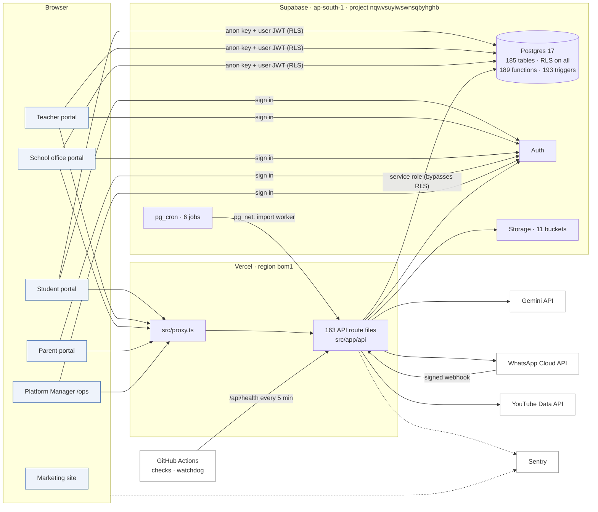
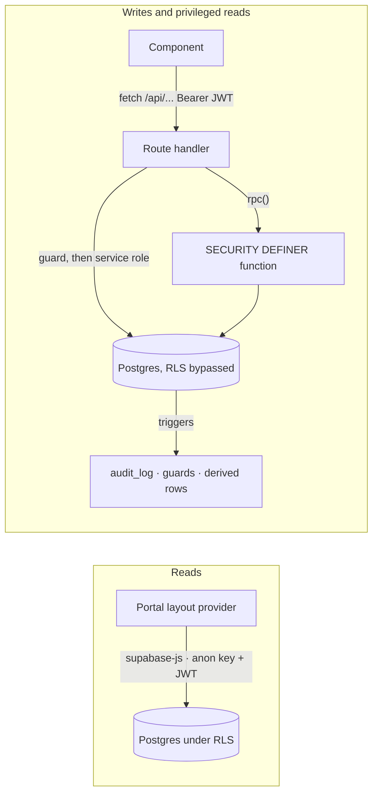

# Sthara School OS: system design

How the platform is put together: the parts, how a request moves through them, where data lives, and the controls
around it. Written 2026-10-29 from the code on this branch and the migrations in `supabase/migrations/`. Every
statement here is traceable to a file; where something could not be found in the repo it says so.

| Document | What it holds |
|---|---|
| This file | Architecture, request flows, security model, background work, operations, open issues |
| [reference/api-routes.md](reference/api-routes.md) | All 163 route files: methods, actions, guards, permissions, callers, every table / SQL function / service each can reach |
| [reference/data-model.md](reference/data-model.md) | All 185 tables and 1 view by domain: columns, keys, RLS policies, grants, triggers, readers and writers |
| [reference/sql-functions.md](reference/sql-functions.md) | All 189 SQL functions: signature, security mode, execute grants, tables touched, callers, source |
| [reference/pages.md](reference/pages.md) | All 124 pages and 10 layouts: API calls and direct database reads |
| [reference/jobs-and-integrations.md](reference/jobs-and-integrations.md) | pg_cron jobs, machine-called routes, storage buckets and policies, realtime |
| [**Sthara Flow Atlas**](https://claude.ai/artifact/3Rc6fg6Z1bbGe7oBWTh8Cj) (interactive; private until shared from its Share menu) | The same data as a playable map: step through any route, page, journey or cron job lane by lane |

---

## 1. System context



- **One Next.js 16.2 app** (`package.json`: `next 16.2.6`, React 19.2) serves the five portals, the API and the
  marketing site. The marketing site in `site/` is built into `public/site` before `dev` and `build`. Its clean
  URLs (`/`, `/about`, `/for/...`) are rewrites in `next.config.ts`, with their own security headers.
- **Hosting:** Vercel, one region, `bom1` (`vercel.json`).
- **Database, auth and files:** one Supabase project in Mumbai (`ap-south-1`, Postgres 17, **free tier**, per
  `docs/disaster-recovery.md`).
- **AI:** Gemini through `@google/genai`. Models are chosen per job in `src/lib/settings/limits.ts` (`AI_MODELS`):
  `gemini-2.5-flash` for standard work and handwriting, `gemini-2.5-pro` for deep work, `gemini-2.5-flash-lite`
  for the tutor's grounding check, and `gemini-2.5-flash-image` for Copilot illustrations.
- **Messaging:** WhatsApp Business via the Meta Cloud API (`src/lib/whatsapp`). It runs **simulated** (writing to
  `whatsapp_log` with status `simulated`) until the real credentials are set (`lib/whatsapp/config.ts`).

## 2. Code layout

| Path | Role |
|---|---|
| `src/app/{student,teacher,admin,parent}` | The four school portals (App Router pages and layouts) |
| `src/app/ops` | Platform Manager, the operator console. Returns 404 to non-operators. |
| `src/app/api/**/route.ts` | 163 route files. Each authenticates its own caller. |
| `src/proxy.ts` | Next 16's middleware file. It gates the portal paths and stamps `/api` requests for the request log. |
| `src/lib/<domain>` | Domain logic. Most modules are **pure** (no I/O, unit-tested); a matching `server.ts` or loader does the I/O. |
| `src/contexts/AuthContext.tsx` | Session, profile and school, shared by all portals |
| `src/components/<portal>` | Portal UI |
| `supabase/migrations/` | The schema: a baseline dump (`20261018171721_baseline.sql`) plus 17 later migrations, applied in order |
| `supabase/migrations_archive/` | Migrations folded into the baseline, kept for reference and never re-applied |
| `supabase/schema.sql` | **Historical.** Its header says it drifted from live. Not used here. |
| `scripts/` | Baseline dump and backups (`db/`), CI checks (`check-unbounded-reads`, `check-migration-grants`), watchdog, curriculum generators |
| `qa/` | Playwright e2e and regression packs. Results upload through `/api/qa/runs`. |
| `handoff/`, `docs/handoffs/` | Build briefs (Living Record 01–09, Dusk redesign) |

The repo follows one convention throughout: rules live in pure modules that the browser, the server and the tests
all share. For example, `lib/admin/fees.ts` (ledger shaping), `lib/exams/engine.ts` (schemes and results),
`lib/payroll/engine.ts`, `lib/schedule/solver.ts` (which runs in a Web Worker in the browser) and
`lib/tml/engine.ts`. The server re-runs the same checks the UI shows.

## 3. Tenancy and identity

- **Tenant = a row in `schools`.** Almost every table has a `school_id`. Server code takes the school from the
  caller's own `users` row and never from the request. This rule is written into every `serverAuth.ts`.
- **People = `public.users`**, keyed to `auth.users.id`. `users.role` is one of `student`, `teacher`, `admin`,
  `parent` or `superadmin`. A separate `operator` role exists for Sthara staff who work only in `/ops`
  (`lib/auth/roles.ts`).
- **Office roles** (principal, cashier, registrar, counsellor and so on) are rows in `role_grants`, checked against
  the catalogue in `role_permissions`. Code checks them through `lib/admin/rbac.ts` (`Access.can(perm)`); RLS
  checks them through `app.has_perm()` and `app.user_has_perm()`. A test keeps the two catalogues in step.
- **Parents reach children** only through `guardians` rows with `verified = true` (`lib/parent/serverAuth.ts`).
- **Students** carry a free-text `users.student_class` historically. The Living Record work adds a proper spine:
  `students` (the admission register), `enrolments` (year by year) and `student_changes`. See
  `handoff/living-record/01-student-spine.md`.
- **Operators** are `ops_operators` rows or superadmins (`superadmins` table, or `users.role = 'superadmin'`).
  Their role sets their capabilities and their reach (`all` or `territory`, `lib/ops/roles.ts`,
  `lib/ops/territories.ts`).
- **Logins are created only by Sthara operators** (`lib/ops/accounts.ts`). Schools file `account_requests`, and
  admissions files an enrolment request. Approving one in `/ops/requests` creates the logins with one-time
  temporary passwords (`PATCH /api/ops/requests`).

## 4. Authentication and authorisation

### 4.1 Sign-in

```mermaid
sequenceDiagram
  participant B as Browser (/login)
  participant API as /api/auth/verify-school
  participant AU as Supabase Auth
  participant PG as Postgres (RLS)
  participant PX as src/proxy.ts
  B->>API: POST { schoolCode } (rate-limited per IP)
  API->>PG: schools lookup (service role)
  API-->>B: { valid, schoolId, name }
  B->>AU: signInWithPassword(email, password)
  AU-->>B: session (access + refresh token)
  B->>PG: select role, school_id from users where id = me
  Note over B: account must belong to that school (operators excepted)
  B->>B: set cookies __role, __session (12 h)
  B->>PX: GET /teacher
  PX-->>B: allow if __role may open /teacher, else redirect to own dashboard
  B->>PG: AuthContext loads users + schools; sets __trial_ok
```

- `src/proxy.ts` gates only the **page** paths (`/student`, `/teacher`, `/admin`, `/parent`). It needs a
  `__session` cookie, sends expired or suspended trials to `/trial-expired`, and allows prefixes by the `__role`
  cookie. The comments say plainly that the `__role` cookie is not a security boundary. Real authorisation happens
  in the API and in RLS.
- **Dev bypass:** outside production, `proxy.ts` accepts a `__role` cookie without a session ("Remove before
  shipping"). It is inactive when `NODE_ENV = production`.
- `/ops` pages are gated by their own layout, which checks the operator against the database. `/api/ops/*` answers
  404 to non-operators, so the console can't be discovered.

### 4.2 API routes

Every route authenticates itself with a `Authorization: Bearer <access token>` header (client helpers such as
`useAdminDesk().call`, `useOpsApi`, `useFamily` and `getAuthToken` add it). The guard mix across the 163 files,
from [reference/api-routes.md](reference/api-routes.md#how-to-read-the-guard-column):

| Guard | Files | Who gets through |
|---|---|---|
| `requireAdmin(req, perm?)` | 51 | School office accounts. Permission checked per route or per action (for example `/api/admin/fees` maps each action to `fees.bill`, `fees.collect`, `fees.void` and so on). |
| `operatorFor(req, capability, school?)` | 39 | Sthara operators by capability and territory. 3 also need an open break-glass window (`requireGrant`). |
| `requireStaff` / `requireFeedCaller` | 31 | Teachers and office staff. Teachers are limited to the classes and subjects in their own `users.assignments`. |
| `verifyApiToken` | 22 | Any signed-in user. The route checks the role. |
| `requireParent` | 9 | Parents, through verified guardian links only |
| Secrets and signatures | 6 | `CRON_SECRET`, `IMPORT_WORKER_SECRET`, QA upload token (2 routes), biometric device token, Meta webhook signature |
| Browser error intake | 1 | `/api/errors`: same-origin, rate-limited per IP, attaches the user from the session cookie when present |
| Public | 4 | `/api/health`, `/api/platform/public`, `/api/auth/verify-school` (rate-limited), `/api/contact` (Turnstile) |

All the user-facing guards go through `verifyApiToken`, which:

1. verifies the JWT with `auth.getUser`;
2. loads the `users` row;
3. applies `schoolAccessBlock` (school suspended, or trial expired);
4. calls `noteRequest` for the request explorer.

Route handlers then use **`createAdminClient()` (service role, bypasses RLS)**, so the guard and the
`.eq('school_id', …)` filters in code are the tenant boundary for writes.

### 4.3 Row-level security

All 185 `public` tables have RLS enabled (108 policies). RLS matters for the browser's **direct reads**. The
student, teacher and admin desks read Postgres straight from the browser with the anon key and the user's JWT
(section 5). Grants to `anon`, `authenticated` and `service_role` are explicit per table, because Supabase stops
granting new tables by default on 2026-10-30. `npm run check:grants` (CI) enforces this.

### 4.4 Platform controls

| Control | Where | Effect |
|---|---|---|
| Suspension | `lib/settings/suspension.ts` | A suspended school's accounts are **banned in Supabase Auth**, so existing sessions can't refresh or keep reading |
| Trial expiry | `lib/settings/server.ts` (`schoolAccessBlock`) | Every authenticated API route refuses; the proxy redirects pages |
| Kill switches | `lib/settings/switches.ts` | Turn parts of the product off for one school (`schools.settings.switches`) |
| AI gate | `aiGate()` in `lib/settings/server.ts` | Pauses AI platform-wide, per school, or per area, before any model client is created |
| Break-glass | `lib/ops/access.ts` | Operators see counts by default. Opening a school's records needs a written reason and a 30-minute window; everything opened is logged in `ops_access_events` and shown to the school's admins. |
| Rate limits | `lib/settings/limits.ts` + `lib/rateLimit.ts` | 35 named limits (per user, IP, or both), shown in the ops Settings module |

## 5. How data moves

There are two paths to the database, and every page uses one or both.



- **Desk providers read directly.** `StudentDeskProvider` (`lib/student/useStudentDesk.ts`),
  `TeacherDeskProvider` and `AdminDeskProvider` (`lib/admin/loadRows.ts`, about 27 tables in parallel) load their
  rows in the browser under RLS. They then shape them with pure functions (`lib/*/desk.ts`, `shape.ts`).
  `next.config.ts` sets `staleTimes.dynamic = 30` so tab switches reuse the payload.
- **Parents and operators always go through the API.** The parent layout calls `GET /api/parent/desk`, which loads
  verified children server-side. Ops pages call `/api/ops/*` through `useOpsApi`.
- **Writes go through API routes.** Money, offers, seats, receipts and numbering go through SQL functions
  (`admin_record_payment`, `admin_raise_invoices`, `admin_close_day`, `admission_offer_*`, `app.next_doc_no`).
  These take locks and raise coded errors; `lib/admin/admissionsServer.ts` maps the codes to answers.
- **Triggers do the bookkeeping.** `app.audit` writes `audit_log` on **75 tables**. Guard triggers
  (`app.guard_fee_payment` and others) refuse illegal changes, and other triggers keep legacy fields in step (for
  example, subject links mirror into `classes.metadata` and `users.assignments`, per `lib/subjects/server.ts`).
- **The 1,000-row ceiling.** PostgREST returns at most 1,000 rows without saying so. Growing reads go through
  `pageAll()` / `all()` (`lib/ops/page.ts`), `npm run check:reads` (CI) fails new unbounded reads, and both the
  browser and the server clients log a list cut at the ceiling to the ops error log (`lib/supabase/watch.ts`).
- **Realtime:** `notifications`, `situations` and `student_chats` are in the `supabase_realtime` publication.

## 6. Data model

185 tables in `public` (plus 2 in `sandbox_seed`) and 1 view (`assignments_student`, which strips the answer key).
Grouped by domain:

| Domain | Tables | Notes |
|---|---|---|
| Tenancy, identity & access | 11 | `schools`, `users`, `role_grants`, `role_permissions`, `guardians`, `consents`, `audit_log`, `platform_config`, `settings_changes` |
| Living Record: student spine | 8 | `students`, `enrolments`, `student_changes`, family and siblings, change requests, `legacy_results` |
| Living Record: health & documents | 7 | `student_health`, `health_events`, `student_documents`, `certificates` (+ types, settings), `doc_counters` |
| Co-curricular (Kirti) | 6 | houses, clubs and teams, `kirti_entries`, `house_points` |
| Conduct, wellbeing & safeguarding | 10 | discipline, counselling (encrypted), `safeguarding_log` (encrypted), `incidents`, `wellness_logs`, `situations` |
| Curriculum & teaching plan | 11 | classes and subject links, `syllabus`, `course_plans`, `lesson_plans`, `learning_outcomes`, `materials` |
| Assignments, grading & TML | 6 | `assignments`, `submissions`, `submission_items` (evidence), `tml_scores` (append-only snapshots), `engagement_scores` |
| AI tutor | 5 | `tutor_sessions`, `tutor_session_turns`, `tutor_guard_events`, `student_chats`, `student_memory` |
| Live Lab & practicals | 4 | `lab_scenes`, `lab_runs`, `practical_assessment`, `practical_progress` |
| Exams & report cards | 9 | schemes, terms, assessments, sheets, marks, frozen `report_cards` |
| Student attendance | 1 | `attendance` |
| Admissions | 6 | applicants, events, school-defined stages, seats, offers, documents |
| Fees | 6 | structures, invoices, payments, reminders, concession requests, day closes |
| Scheduling & timetable | 15 | wings, bells, rooms, calendar, timetable versions and slots, solver input, cover, duties, visits |
| HR & staff attendance | 25 | staff register and dated jobs, profiles, statutory, exits, leave, shifts, punches, day marks, no-show alerts |
| Payroll | 13 | pay items, templates, salaries, runs and lines, loans, statutory rates, tax declarations |
| Messaging & WhatsApp | 5 | `notifications`, `school_threads`, `school_messages`, `whatsapp_links`, `whatsapp_log` |
| Compliance | 1 | `school_filings` |
| Bulk import | 2 | `import_jobs`, `import_changes` (the undo journal) |
| Platform Manager (Sthara ops) | 31 | operators, territories, CRM, service desk, pipeline, quotes, partners and commissions, marketing, break-glass, QA runs |
| Observability & metering | 4 | `app_errors`, `app_error_groups`, `request_log`, `ai_usage` |

Conventions visible in the schema:

- **Two schemas.**
  - `public` holds the tables and the 85 functions the API may call (`rpc`).
  - `app` holds 104 internal helpers: permission checks, guards, audit, numbering.
  - 146 of the 189 functions are `SECURITY DEFINER` with a pinned `search_path` (archived migration
    `20260923183000_pin_function_search_path.sql`).
  - `service_role` has **no USAGE on `app`**. Any trigger whose body calls `app.*` must be `SECURITY DEFINER`, or
    service-role writes fail (`handoff/living-record/README.md`, "the wellness-acknowledge bug").
- **Derived, never stored, where money is concerned.** Fee balances are recomputed from receipts
  (`lib/admin/fees.ts`), and payroll lines are reproducible from their inputs (`lib/payroll/engine.ts`).
- **Snapshots where history matters.** Report cards freeze everything they show (`lib/exams/card.ts`), certificates
  freeze their values at issue (`lib/certificates/pdf.ts`), and `tml_scores` is append-only.
- **Encrypted personal data.** Aadhaar numbers (`students.aadhaar_cipher`, plus the last 4 digits and a keyed
  hash), counselling notes and referrals, and child-protection steps are sealed with AES-256-GCM under
  `STUDENT_PII_KEY` (`lib/students/pii.ts`). The database and its audit trail hold only ciphertext.

## 7. Modules

Each line names the main routes and tables. The full lists are in the reference docs, and the Flow Atlas plays
each one.

- **Student "Honest Desk":** homework (`/api/student/submit-typed` grades MCQs against the key on the server; photo
  pages go to `captures` via `/api/grading/pages`, then `/api/homework/grade`), the AI tutor
  (`/api/tutor/session`), mastery (`/api/tml/compute`), exam track, Kirti, and wellness (consent-gated in RLS).
- **Teacher:** assignments and quizzes (`/api/teacher/assignments`, AI generators `quiz-gen` and `homework-gen`),
  capture and review (`/api/teacher/capture`, `/api/teacher/review-submission`), attendance and feed, syllabus and
  lesson plans (`course`, `lessons`, `lessons/draft`), Copilot (`/api/teacher/copilot`, `copilot/image`), Live Lab
  and CBSE practicals, exams mark entry, conduct, Kirti, leave, cover, and Ask the School OS (`/api/staff/ask`).
- **School office:** fees, admissions (pipeline, maker-checker offers, enrolment requests), students (register,
  year-end outcomes, documents, health, family), certificates (TC, bonafide, character; PDF via `pdf-lib`;
  public QR check at `/verify/[token]`), exams and report cards, HR (`/api/admin/people/*`), payroll (runs, exports,
  payslips), scheduling (timetable builder and solver, calendar, cover, duties, staff attendance, biometric
  devices), discipline, counselling, safeguarding, co-curricular, compliance filings, Probe (deterministic findings
  over the desk, `lib/admin/probe.ts`), bulk import, and the support desk.
- **Parent:** the family view (`/api/parent/desk`), Ask the School OS (`/api/parent/ask`) on the web and on
  WhatsApp, messages, documents, health, conduct, Kirti, timeline, report cards (`/api/me/report-cards`) and
  year-end results.
- **Platform Manager (`/ops`):** overview and school health (counts only, from `ops_school_metrics()`), schools
  (settings, controls, people, subjects, support fixes, import on behalf, break-glass inspector), requests, service
  desk with SLAs, pipeline, quotes, partners and commissions, marketing, territories, operators, usage (AI cost),
  traffic (request explorer), errors, delivery (WhatsApp), quality (QA runs), audit, and platform settings.
- **Living Record timeline:** `/api/timeline` assembles a year-by-year view filtered by the viewer's "lens"
  (`lib/timeline/rules.ts`). Its Ask mode never sees counselling or child-protection data.

## 8. AI subsystem

- **16 route files reach Gemini:**
  - student-facing: `tutor/session`, `quiz/generate`, `quiz/grade`, `homework/grade`;
  - teacher-facing: `teacher/{copilot, copilot/image, capture, quiz-gen, homework-gen, lessons/draft}`,
    `paper-gen`;
  - Ask the School OS: `parent/ask`, `staff/ask`, `timeline`;
  - WhatsApp: `whatsapp/webhook`, `whatsapp/simulate` (Ask over WhatsApp).
- **Gate, then meter.** `aiGate()` runs before a client is created. `generateMetered()` / `recordRestUsage()`
  write one `ai_usage` row per call, with tokens and the cost at that moment (`lib/ai/pricing.ts`). The write
  happens after the response is sent (`after()`), so metering never blocks a call. `lib/ai/retry.ts` treats a
  busy model (503) differently from an exhausted quota (429).
- **The AI suggests and people decide.** Handwriting grades are suggestions until a teacher confirms them
  (`lib/grading/handwritten.ts`). Live Lab numbers come from tested engines, and the model only picks the set-up
  (`lib/lab/types.ts`). Board-pattern papers take their marks from the CBSE design, never from the model
  (`lib/papers/paper.ts`).
- **Tutor safety:**
  - every message is checked against the student's own syllabus (`lib/tutor/grounding.ts`, a `flash-lite`
    classifier);
  - profanity and safety cues are handled before any model call and raised to staff through the situational feed
    (`lib/tutor/groundingServer.ts`);
  - scoring state rides in an HMAC-signed token (`TUTOR_SESSION_SECRET`).
- **Untrusted model output.** Copilot SVG is rebuilt from a whitelist of shapes (`lib/teacher/svg.ts`). Ask
  replies are strict JSON protocols (`lib/parent/ask.ts`, `lib/staff/ask.ts`), and the staff brief replaces every
  person with a token (`lib/staff/brief.ts`).

## 9. Messaging and notifications

- **In-app:** `notifications`, delivered through realtime.
- **Escalations:** the situational feed (`situations`, `lib/feed/rules.ts`) raises items, which can escalate to
  the principal.
- **WhatsApp** (`lib/whatsapp/send.ts`, 25 route files can reach it):
  - outbound sends respect the 24-hour service window, use templates otherwise (`WHATSAPP_TEMPLATE_*`), and log to
    `whatsapp_log`;
  - a per-school switch can block sends;
  - numbers are linked with a 6-digit code (`lib/whatsapp/link.ts`);
  - inbound is `POST /api/whatsapp/webhook`: it verifies the `x-hub-signature-256` HMAC, answers 200 at once and
    handles each message after the response.
- **Staff commands** over WhatsApp (`IN`, `OUT`, `LEAVE …`, `ACK`, `TODAY`) are parsed in
  `lib/attendance/commands.ts` and `lib/staff/commands.ts`.

## 10. Background work

| Job | Where | Schedule (UTC) | What it does |
|---|---|---|---|
| `hr-daily` | pg_cron | `35 18 * * *` (00:05 IST) | `public.hr_daily()` |
| `admission-sweep` | pg_cron | `45 18 * * *` | `public.admission_sweep()` |
| `request-log-prune` | pg_cron | `15 19 * * *` | deletes `request_log` older than 7 days |
| `import-undo-purge` | pg_cron | `45 19 * * *` | deletes `import_changes` of imports committed over 30 days ago |
| `health-retention` | pg_cron | `30 20 * * *` | `public.health_retention_purge()` |
| `import-worker` | pg_cron + pg_net | every minute | while a job waits, POSTs to `/api/import/worker` using the URL and secret held in **Supabase Vault** (`import_worker_url`, `import_worker_secret`) |
| Watchdog | GitHub Actions | every 5 min | `scripts/watchdog.mjs` probes `/api/health` (a database round-trip, which also stops the free project pausing) and keeps a Jira issue open while it fails |
| Staff no-show check | `/api/cron/attendance` | **not scheduled** | The route doc says a scheduler is "pending setup". Until then the check runs when the cover or attendance board is opened. |

**Bulk import** (`lib/import/server.ts`):

1. The browser creates a job and uploads the file straight to the private `imports` bucket through a signed URL,
   which avoids Vercel's 4.5 MB request limit.
2. A worker moves the job a step at a time:
   `uploading → checking → checked → committing → committed → undoing → undone`.
3. The import routes kick the worker in-process after each step. pg_cron is the fallback.
4. Every write is journaled in `import_changes`, so an import can be undone for 30 days.

Ops can run imports for a school under a break-glass `import` window.

## 11. Observability

- **Errors:**
  - Sentry is set up for client, server and edge (`sentry.*.config.ts`, `src/instrumentation*.ts`; server traces
    sampled at 0.2).
  - Server errors and every server `console.error` go to the ops error log (`app_errors` via `log_app_error`,
    grouped by fingerprint, in `lib/errors/`).
  - Browser errors arrive through `POST /api/errors`.
- **Silent database failures:** refused requests and lists cut at 1,000 rows on the browser's direct reads are
  reported by `lib/supabase/watch.ts`.
- **Request explorer:** the proxy stamps each `/api` request, and the guard records who asked. One `request_log`
  row is written after the response, so its duration covers the whole request. The log is pruned after 7 days.
- **AI usage and cost:** `ai_usage`, shown on `/ops/usage`.
- **Job runs:** app-side jobs that are safe to repeat are listed in `lib/debug/jobs.ts`, with history in
  `ops_job_runs`.

## 12. Security and privacy controls

- **Tenant isolation:** the school always comes from the caller's database row, never the request. RLS covers
  direct reads, and the guards plus explicit `school_id` filters cover service-role code.
- **Least privilege in the UI:** office permissions are re-checked on the server per action, never only by hiding
  a button.
- **Grade integrity:** browsers can't write scores (archived migration `20260923120000_harden_schema.sql`), MCQs
  are graded on the server, and the answer key is hidden until the whole class is graded
  (`lib/student/answerKey.ts`).
- **Maker-checker** for offers, concessions, certificates, discipline actions, payroll runs and year-end outcomes.
- **Personal data (DPDP):**
  - Aadhaar and counselling text are encrypted;
  - the consented part of the health record is refused without consent, in the database;
  - counselling content is readable only by the counsellor, and child-protection only by the safeguarding lead
    (or the principal if there is none);
  - sensitive reads are recorded.
- **Operator access:** counts by default, with time-boxed and audited break-glass for records.
- **Secrets:** server secrets live only in Vercel env vars. The anon key in `lib/supabase/client.ts` is the public
  key and is meant to be in the browser.

## 13. Reliability and recovery

Summarised from `docs/disaster-recovery.md`:

- **No downloadable backups or point-in-time recovery on the free tier.** The only off-site copy is the encrypted
  file from `scripts/db/backup.sh` (schema, data, auth users with password hashes, storage).
- **A full rebuild** replays the migrations in order and restores the data with triggers off. The schema rebuild
  was rehearsed on 2026-10-20 (4,200 of 4,201 objects matched). The data and file restore steps have **not** been
  rehearsed yet.
- **Settings outside the repo:**
  - Supabase Auth dashboard settings, whose table in the DR doc is still blank;
  - Vault secrets;
  - `STUDENT_PII_KEY`. If it is lost, every Aadhaar number has to be collected again.
- **Paused project:** the watchdog's 5-minute health probe keeps the free project from pausing. GitHub disables
  scheduled workflows after 60 days without repo activity.

## 14. Development and CI

- **Local:** `npm run dev` builds the site and the solver worker, then starts Next. Without Supabase keys the
  portals fall back to demo data (`lib/demo/`, `AuthContext`).
- **Checks:**
  - `npm run typecheck`, `npm run lint` and `npm test` (unit tests over the pure modules and the site);
  - `npm run check:reads` (unbounded reads against a baseline);
  - `npm run check:grants` (every new table grants explicitly);
  - Playwright suites in `qa/`.
- **CI** (`.github/workflows/checks.yml`, on PRs and pushes to `main`) runs `check:reads` and `check:grants`.
  Typecheck, lint and unit tests are not in that workflow.
- **Database changes** are written as migrations and applied by hand (`npm run db:push`). The Living Record
  handoff says only Moses applies them.

## 15. Configuration

Read in `src/`:

- Supabase: `NEXT_PUBLIC_SUPABASE_URL`, `NEXT_PUBLIC_SUPABASE_ANON_KEY`, `SUPABASE_SERVICE_ROLE_KEY`
- AI: `GEMINI_API_KEY`
- Secrets: `TUTOR_SESSION_SECRET`, `STUDENT_PII_KEY`, `CRON_SECRET`, `IMPORT_WORKER_SECRET`
- WhatsApp: `WHATSAPP_ACCESS_TOKEN`, `WHATSAPP_PHONE_NUMBER_ID`, `WHATSAPP_APP_SECRET`, `WHATSAPP_VERIFY_TOKEN`,
  `WHATSAPP_BUSINESS_NUMBER`, `WHATSAPP_TEMPLATE_OTP`, `WHATSAPP_TEMPLATE_ALERT`
- Other services: `YOUTUBE_API_KEY`, `NEXT_PUBLIC_SENTRY_DSN`
- Runtime: `NEXT_PUBLIC_SITE_URL`, `STHARA_ERROR_LOG`, and the Vercel runtime variables

`SENTRY_DSN` is read in `sentry.server.config.ts`. The DR doc also lists `POLICIES_APPROVED`, `RESEND_API_KEY` and
`TURNSTILE_SECRET_KEY`. Values never leave the ops Settings module, which reports only whether each is present
(`lib/settings/collect.ts`).

## 16. Open issues found while mapping

These come straight from the code. None were tested against production.

1. **The staff no-show check isn't scheduled.** `/api/cron/attendance` exists behind `CRON_SECRET`, but nothing in
   the repo calls it.
2. **Rate limits are per server instance.** `lib/rateLimit.ts` keeps counters in memory (the file says so). With
   several Vercel instances the effective limit is higher than configured. This matters most for the AI routes and
   the sign-in code lookup.
3. **`/api/admin/subjects` has no caller** in `src/`, `site/` or `qa/`. A similar operator route,
   `/api/ops/schools/[id]/subjects`, is in use.
4. **Nine writes choose their table at runtime** (`db.from(table)`), in `admin/attendance`, `admin/people`,
   `admin/people/structure`, `admin/people/import`, `admin/schedule/setup`, `ops/marketing`,
   `teacher/acknowledge-situation` and `lib/subjects/server.ts`. Static tools (and this map) can only list
   candidates. The guards around them are worth keeping tight.
5. **The CI workflow doesn't run typecheck, lint or the unit tests.** It runs only the reads and grants checks.
   Those three run only when someone runs them locally.
6. **`supabase/schema.sql` is stale** by its own header. Anyone reading it for the current schema will be misled.
   Consider removing it or pointing it at the migrations.
7. **The Auth settings table in `docs/disaster-recovery.md` is empty**, and the data restore has not been
   rehearsed.

## 17. Key journeys

The Flow Atlas plays each of these step by step, through every function, table, trigger and external call on the
path:

1. sign-in;
2. a student's desk;
3. an AI tutor session;
4. typed homework from set to confirmed;
5. photographed work and AI marking;
6. class attendance and the feed;
7. fees from structure to day close;
8. admission to enrolment, including operator approval;
9. bulk import with the pg_cron worker;
10. the parent portal, Ask and WhatsApp;
11. marks to published report cards;
12. a payroll run;
13. a transfer certificate and its QR check;
14. operator break-glass;
15. health, errors and scheduled jobs.

## How this was produced

- **Schema:** all 18 migrations were replayed in order into a scratch PostgreSQL 16 database with stubs for
  Supabase's `auth`, `storage`, `cron`, `vault` and `net` schemas. All 18 applied with zero errors once the
  PG17-only `MAINTAIN` grant, the `pg_net` extension and the realtime publication were handled. The catalogue
  (tables, columns, constraints, indexes, policies, grants, triggers, functions, cron jobs, buckets) was read from
  that database. **The live database was not queried and no row data was read.**
- **Code:** every `.ts` and `.tsx` file under `src/` was parsed with the TypeScript compiler API. For each function
  the parser records, in source order:
  - Supabase `.from()` table operations, `.rpc()`, storage, auth and realtime calls;
  - `fetch` targets, Gemini calls and environment variables read;
  - calls into other functions (through imports and re-exports);
  - which `action` branch each call sits in.

  Routes and pages are joined by matching `/api/...` strings in client code.
- **SQL function bodies** are scanned for the tables they read and write and the functions they call. Triggers are
  matched to the operations that fire them.
- **Limits of static tracing:**
  - A trace lists every call a path *can* make, across all branches. It doesn't evaluate conditions.
  - Tables chosen at runtime are shown as candidates.
  - Callers outside this repo (Meta, biometric devices, the QA uploader, the watchdog, pg_cron) were added by hand
    from the files that document them.

The generator scripts are not committed with these docs. Ask for them if the reference files should be regenerated
in CI.
